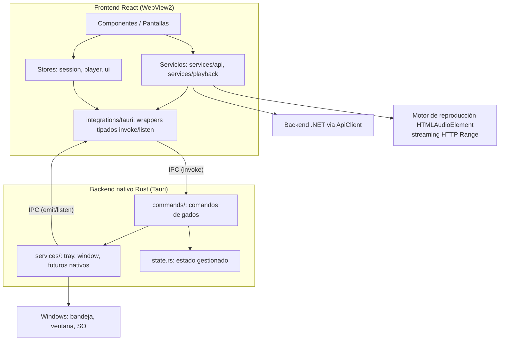

# Arquitectura de Desktop

Arquitectura de la aplicación Tauri 2 para Windows: separación entre frontend React y backend nativo Rust, comandos, eventos, servicios, estado y acceso a capacidades del sistema operativo.

> Complementa a [../../docs/global-architecture.md](../../../docs/global-architecture.md). Principios obligatorios: [../../docs/architecture-principles.md](../../../docs/architecture-principles.md).

## Visión general



## Responsabilidades: ¿React o Rust?

| Necesidad | Dónde vive | Regla |
|---|---|---|
| Render, navegación, formularios | React | — |
| Lógica de producto (cola, favoritos, reglas de UI) | React (stores/servicios) | Sin lógica de negocio en comandos |
| Comunicación HTTP con backend | React (`services/api/`) | Ver [../../docs/api-integration.md](../../../docs/api-integration.md) |
| Reproducción de audio | React (`services/playback/`) | Ver [audio-playback.md](audio-playback.md) |
| System Tray, menú de bandeja, ocultar/mostrar ventana | Rust | Ver [system-tray.md](system-tray.md) |
| Ciclo de ventana (close-to-tray, geometría) | Rust | Eventos de ventana en Rust |
| Teclas multimedia de Windows (SMTC), rutas del SO, archivos locales | Rust (futuro) | Solo capacidades nativas |
| Preferencias simples de UI | React (almacenamiento por plataforma) | Preferencias no sensibles |

**Regla de decisión:** si una operación se resuelve correctamente en el frontend con las APIs web/Tauri disponibles, **no** se crea un comando Tauri. Los comandos existen para lo que el WebView no puede hacer (o hace peor): bandeja, ventanas, integración nativa, acceso privilegiado.

## Comandos Tauri

- **Delgados:** validan argumentos, delegan en un servicio (`services/`) y devuelven `Result<T, AppErrorDto>`. Sin HTTP, sin reglas de negocio, sin transformaciones complejas.
- **Tipados:** el frontend los consume a través de wrappers en `integrations/tauri/` (nunca `invoke("nombre")` suelto en componentes).
- **Errores:** devuelven `Result` con mensaje/`code` serializable; el frontend los traduce a `AppError` (ver [../../docs/error-handling.md](../../../docs/error-handling.md)).
- **Async:** toda operación de I/O es `async` o corta; nunca bloquear el hilo principal.
- Ejemplo de forma esperada:

```rust
#[tauri::command]
pub fn set_playback_state(app: AppHandle, playing: bool, title: Option<String>) -> Result<(), AppError> {
    tray::update_tray_menu(&app, playing, title.as_deref())   // delega en servicio
}
```

## Eventos Tauri

- **Frontend → Rust:** para actualizar estado nativo (p. ej. título en bandeja al cambiar de pista).
- **Rust → Frontend:** para que la UI reaccione a acciones nativas (p. ej. "Reproducir/Pausar" desde el menú de bandeja).
- **Convención de nombres:** `dominio:accion` — ejemplo: `player:next`, `window:show`; la acción de play/pause originada en la bandeja usa el dominio `tray` (`tray:toggle-play`, ver [system-tray.md](system-tray.md)).
- Todo `listen()` se limpia al desmontar (retorno de la función de suscripción); los wrappers centralizan la suscripción para evitar fugas.
- **Un solo dueño del estado de reproducción:** el store de reproducción de React (ver [../../docs/global-architecture.md](../../../docs/global-architecture.md#gestión-del-estado)); Rust nunca guarda una copia del estado del reproductor, solo recibe datos para reflejarlos en la bandeja.

## Servicios Rust

| Servicio | Responsabilidad |
|---|---|
| `services/tray.rs` | Crear bandeja, menú contextual, manejar eventos de menú/clip, actualizar textos |
| `services/window.rs` | Ocultar/mostrar/foco de la ventana principal, persistencia de geometría (plugin `window-state`) |
| `futuro: services/smct.rs` | Integración con controles multimedia de Windows (solo si fase 2 de [audio-playback.md](audio-playback.md) lo requiere) |

Los servicios se ensamblan en `.setup()` de `lib.rs`. No acceden a React salvo mediante `app.emit(...)`.

## Gestión de estado

| Estado | Dueño | Mecanismo |
|---|---|---|
| Reproducción (pista, cola, posición, volumen) | Store de React | Zustand (evaluar al implementar; Context solo si el grafo es mínimo) |
| Sesión/auth | Store de React | Alimenta al `ApiClient` |
| UI (sidebar, modales, toasts) | Store/context local | — |
| Estado nativo (visibilidad de ventana, textos de bandeja) | Rust (`state.rs` + `TrayIcon`) | `app.manage()` si varios comandos lo comparten |
| Preferencias de usuario | Almacenamiento local por plataforma | `localStorage` solo para preferencias no sensibles; tokens → almacén seguro (ver [../../docs/security.md](../../../docs/security.md#almacenamiento-seguro-de-tokens)) |

## Configuración

- `src-tauri/tauri.conf.json`: ventana (título, tamaño mínimo, `minSize`), bundle, CSP (debe dejar de ser `null`, ver [../../docs/security.md](../../../docs/security.md)).
- `src-tauri/capabilities/*.json`: permisos mínimos por ventana (`core:default`, `opener:default` hoy; agregar solo permisos usados por features nuevas, p. ej. `core:tray:default` si se usa la API JS de bandeja, `http:default` si se usa `plugin-http`).
- Variables de entorno del frontend: `VITE_API_BASE_URL` (ver [../../docs/api-integration.md](../../../docs/api-integration.md#configuración-de-url-base)).

## Acceso a capacidades de Windows

- **Bandeja del sistema:** ver [system-tray.md](system-tray.md).
- **Teclas multimedia/SMTC:** fase 2 en Rust, ver [audio-playback.md](audio-playback.md#integración-con-controles-multimedia-de-windows-fase-2).
- **Rutas de usuario:** usar APIs de directorios del SO (crate `dirs`/`known-folders`) nunca rutas hardcodeadas (`C:\Users\...`).
- **Archivos locales:** solo si aparece la necesidad, con scope mínimo (capabilidad `fs` específica, nunca global).
- **Abrir enlaces externos:** `tauri-plugin-opener` (ya instalado), nunca `shell:open` con strings arbitrarios.

## Separación interfaz / lógica de negocio

- Componentes: render + emisión de intenciones (callbacks) — sin fetch, sin `invoke`, sin reglas.
- Stores/servicios: orquestación y lógica.
- `integrations/tauri/`: único punto que conoce `invoke`/eventos de Tauri.
- Rust: capacidades nativas; sin reglas de producto.

## Deudas detectadas (estado actual)

| Deuda | Impacto | Tratamiento |
|---|---|---|
| `"csp": null` | Sin política de seguridad en el webview | Habilitar CSP al tocar seguridad (ADR-012) |
| `productName`/título/identificador = "tauri-app" | Sin identidad de producto | Renombrar al definir branding |
| Sin `minSize` de ventana ni `window-state` | Ventana muy pequeña; no recuerda tamaño | Agregar plugin `window-state` con [system-tray.md](system-tray.md)/ventana |
| Comando `greet` y CSS/assets de plantilla | Código muerto | Eliminar al tocar esa área |
| `strict` presente en Desktop pero ausente en Web | — | Mantener el de Desktop; habilitarlo en Web al tocar su tsconfig (ADR-012); alinear versiones TS/React entre Desktop y Web |
| `framer-motion` en `devDependencies` | Riesgo de build | Mover a `dependencies` al tocar `package.json` |
| Sin pruebas | — | Ver [testing.md](testing.md) |
