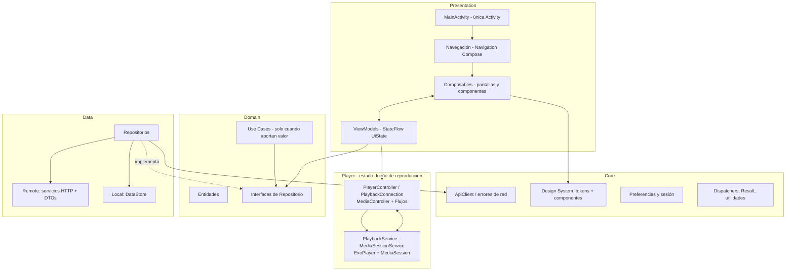

# Arquitectura Android

Arquitectura modular de la aplicación Mobile basada en buenas prácticas de Android moderno, sin capas innecesarias (KISS/YAGNI, ver [../../docs/architecture-principles.md](../../../docs/architecture-principles.md)).

> Complementa a [../../docs/global-architecture.md](../../../docs/global-architecture.md).

## Visión general



## Capas y responsabilidades

### Presentation

- **Pantallas (Composables)**: renderizan `UiState` y emiten callbacks. Sin red, sin reglas de negocio, sin `MediaController` directo.
- **Componentes**: design system propio (`core/designsystem/`) + componentes de feature.
- **Navegación**: un grafo único (Navigation Compose) con rutas tipadas por feature; el `NavController` no se pasa por capas intermedias innecesarias.
- **ViewModels**:
  - Un ViewModel por pantalla/flujo; exponen `StateFlow<UiState>` inmutables.
  - Ejecutan casos de uso/repositorios en `viewModelScope`; mapean resultados (incluidos errores) a `UiState`.
  - **No** referencias a `Context`/`Activity` (salvo `AndroidViewModel` solo si es imprescindible y justificado).
  - Para reproducción: el ViewModel **no** es dueño del reproductor; observa `PlayerController` (ver abajo).

### Domain

- **Entidades** del producto (`Track`, `Album`, `Artist`, `Playlist`…).
- **Interfaces de repositorio** (contratos entre presentation y data).
- **Use cases**: **solo cuando aporten valor real** — lógica de negocio reutilizada por varios ViewModels o no trivial (p. ej. "construir cola con shuffle"). Si es una llamada directa al repositorio desde un ViewModel, no se crea use case (YAGNI).
- Sin dependencias de Android, red ni UI (puro Kotlin → testeable unitariamente).

### Data

- **Repositorios (implementación)**: orquestan remote/local, mapean DTOs → entidades, aplican políticas de caché y error.
- **Remote**: servicios que usan `core/network/ApiClient` + DTOs JSON (`data/remote/dto/`) + mapeadores. Retrofit/OkHttp queda como objetivo si crece el número de endpoints.
- **Local**: DataStore para preferencias/sesión/última posición (sin Room hasta que exista necesidad real de caché offline — ADR: evaluar al implementar).
- Implementa las interfaces de domain; presentation solo ve la interfaz (Dependency Inversion).

### Core

- **Network**: `ApiClient` central (`HttpURLConnection` + `org.json`, sin dependencias nuevas), catálogo de rutas relativas en `Endpoints.kt`, errores normalizados en `ApiError` y mapeo a mensajes en cada ViewModel (ver [../../docs/api-integration.md](../../../docs/api-integration.md) y ADR-016). La URL base la aporta el servidor activo configurado por el usuario.
- **Design System**: tokens de color/tipografía/shape + componentes comunes (`AntaraTheme` personalizado, botones, cards, filas, skeletons, toasts).
- **DataStore**: sesión y preferencias con acceso centralizado (y cifrado cuando sea información sensible, ver [../../docs/security.md](../../../docs/security.md#almacenamiento-seguro-de-tokens)).
- **Common**: `AppResult`/tipos de error, extensiones, `DispatcherProvider` (para tests).

### Player (paquete propio, no una capa más)

La reproducción vive **fuera** de presentation/domain/data porque su dueño es el **sistema** (ver [background-playback.md](background-playback.md)):

- `PlaybackService` (`MediaSessionService`): dueño de `ExoPlayer` + `MediaSession`.
- `PlayerController`: envoltorio tipado de `MediaController` (conexión, acciones, `StateFlow` de estado).
- `PlaybackConnection`: conecta ViewModels/UI con el servicio (token → `MediaController`).

## MVVM + flujo de datos unidireccional

```text
Evento usuario → Composable → callback → ViewModel → (Repositorio | PlayerController)
     ↑                                                          ↓
     └──────────── StateFlow<UiState> / StateFlow<PlayerUiState> ┘
```

- Un solo sentido del dato; sin estado duplicado (ADR-011 en [../../docs/decisions/README.md](../../../docs/decisions/README.md)).
- `UiState` como data class inmutable; se reemplaza, no se muta.
- Estados de carga/vacío/error centralizados (ver [../../docs/error-handling.md](../../../docs/error-handling.md)).

## Inyección de dependencias

- **Contenedor manual** `AppContainer` en `AntaraApplication` (ADR-006): construye repositories, use cases, `DispatcherProvider` y la fábrica de ViewModels (`ViewModelProvider.Factory`).
- Sin singletons con estado fuera del contenedor; sin dependencias ocultas.
- **Migración a Hilt** cuando el grafo supere el umbral razonable (p. ej. >10 módulos) o se necesiten scopes/`@HiltViewModel`; registrar como ADR nuevo.

## Navegación

- `navigation-compose` (dependencia a evaluar/agregar justificadamente al implementar la primera pantalla de navegación).
- Grafo único en `navigation/`; rutas tipadas (string/sealed con argumentos); rutas de argumentos serializables por tipo.
- Back de Android: cierra sheets/menús primero y luego navega hacia atrás (ver [ui-guidelines.md](ui-guidelines.md)).
- Al compartir estado de reproducción entre pantallas, se lee del `PlayerController`, **no** del `SavedStateHandle`.

## Persistencia local

| Dato | Medio |
|---|---|
| Sesión/token | DataStore cifrado (Keystore) |
| Preferencias (tema, último volumen) | DataStore preferences |
| Última pista/posición | DataStore (para restaurar sesión; sin autoplay automático) |
| Cola de reproducción | Backend (fuente de verdad); espejo local opcional para restaurar tras muerte del proceso |
| Biblioteca/caché | No persistir hasta medir necesidad (YAGNI) |

## Estado de reproducción y su dueño

- Dueño: `MediaSession` dentro de `PlaybackService` (ver [media-session.md](media-session.md)).
- La UI observa vía `MediaController`: `Player.Listener` → `StateFlow<PlayerUiState>` (posición vía `currentPosition`/poll razonado, `isPlaying`, `mediaMetadata`, cola).
- **Prohibido** mantener copias del estado de reproducción en ViewModels que "actualicen a mano": se deriva siempre del controller.
- Ver también [background-playback.md](background-playback.md#ciclo-de-vida).

## Qué NO hacer

- Sin lógica de negocio en composables ni en `MainActivity`.
- Sin llamadas HTTP desde ViewModels/Composables (pasar por repositorios).
- Sin segundo reproductor fuera del servicio.
- Sin capas "use case" por costumbre (ver Domain).
- Sin Hilt/KSP/Room/WorkManager hasta que exista requisito justificado y ADR.
