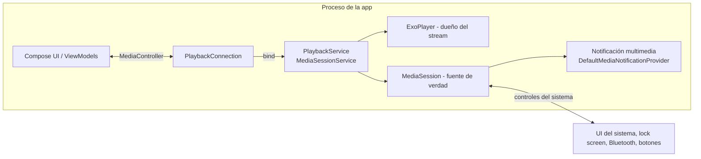

# Reproducción en segundo plano (Background Playback)

Documento **obligatorio** para reproducción musical y ejecución en segundo plano en Android. Cualquier feature que afecte reproducción, servicios o segundo plano debe consultarlo antes de tocar código.

> **No se elimina ni simplifica esta funcionalidad sin justificación técnica documentada** en [../../docs/decisions/README.md](../../../docs/decisions/README.md).

> **Estado actual:** la reproducción en segundo plano **aún no está implementada** (Media3 está declarado sin usar; ver [README.md](README.md)). Este documento define el diseño objetivo (ADR-005).

## Objetivo

La música debe continuar reproduciéndose aunque el usuario:

- Cambie a otra aplicación.
- Regrese a la pantalla principal (home) de Android.
- Bloquee el dispositivo.
- Apague la pantalla.
- Navegue por otras aplicaciones.

La reproducción **no** depende de que la Activity principal permanezca visible.

## Tecnología requerida

**AndroidX Media3 + ExoPlayer** (ya declarados: `media3-exoplayer`, `media3-ui`, `media3-session` 1.4.1 en `app/build.gradle.kts`; hoy sin usar).

Arquitectura: `ExoPlayer` + `MediaSession` dentro de un **`MediaSessionService`** (foreground service), consumido por la UI mediante **`MediaController`**. La notificación la genera `DefaultMediaNotificationProvider` (ver [media-session.md](media-session.md)).



## Separación de responsabilidades

- **La interfaz Jetpack Compose no es propietaria del ciclo de vida del reproductor.** No crea ni posee `ExoPlayer`.
- El reproductor vive en `PlaybackService` (`player/PlaybackService.kt`), que sobrevive a la destrucción de la Activity.
- La UI se comunica con el servicio mediante `MediaController` (patrón recomendado por Media3), envuelto en `PlayerController`/`PlaybackConnection`.
- La **`MediaSession` es la fuente de verdad** del estado expuesto al sistema; la UI deriva su estado del controller (ADR-011).

## Implementación técnica

### 1. El servicio (`player/PlaybackService.kt`)

```kotlin
class PlaybackService : MediaSessionService() {
    private var mediaSession: MediaSession? = null
    private var player: ExoPlayer? = null

    override fun onCreate() {
        super.onCreate()
        val audioAttributes = AudioAttributes.Builder()
            .setContentType(C.AUDIO_CONTENT_TYPE_MUSIC)
            .setUsage(C.USAGE_MEDIA)
            .build()

        player = ExoPlayer.Builder(this)
            .setAudioAttributes(audioAttributes, /* handleAudioFocus = */ true)
            .setHandleAudioBecomingNoisy(true)      // pausa al desconectar auriculares
            .setWakeMode(C.WAKE_MODE_NETWORK)       // mantiene CPU+red con pantalla apagada
            .build()

        mediaSession = MediaSession.Builder(this, player!!)
            .setSessionActivity(/* PendingIntent a MainActivity con FLAG_IMMUTABLE */)
            // .setBitmapLoader(...)  → ver media-session.md (portadas autenticadas)
            .build()
    }

    override fun onGetSession(controllerInfo: MediaSession.ControllerInfo): MediaSession? =
        mediaSession

    override fun onDestroy() {
        mediaSession?.run {
            player.release()
            release()
        }
        mediaSession = null
        player = null
        super.onDestroy()
    }
}
```

Notas clave (verificadas contra Media3 1.4.1 y la guía oficial de `MediaSessionService`):

- `handleAudioFocus = true`: ExoPlayer gestiona Audio Focus (p. ej. pausa al recibir llamada, reanuda según política).
- `setHandleAudioBecomingNoisy(true)`: pausa al desconectar auriculares/cable.
- `setWakeMode(C.WAKE_MODE_NETWORK)`: requiere permiso `WAKE_LOCK` (ver [permissions-and-lifecycle.md](permissions-and-lifecycle.md)); necesario para streaming con pantalla apagada. Evaluar impacto de batería (solo activo durante reproducción).
- Manejo de excepción de inicio en segundo plano (Android 12+): implementar `MediaSessionService.Listener` con `onForegroundServiceStartNotAllowedException()` y actuar en consecuencia (mostrar estado, no crashear).
- La notificación y el foreground service los gestiona Media3 automáticamente según el estado del `Player` (ver "Ciclo de vida" más abajo).

### 2. Declaración en el Manifest (obligatoria)

```xml
<uses-permission android:name="android.permission.INTERNET" />
<uses-permission android:name="android.permission.FOREGROUND_SERVICE" />
<uses-permission android:name="android.permission.FOREGROUND_SERVICE_MEDIA_PLAYBACK" />
<!-- WAKE_LOCK solo si se usa setWakeMode (ver permissions-and-lifecycle.md) -->

<service
    android:name=".player.PlaybackService"
    android:exported="true"
    android:foregroundServiceType="mediaPlayback">
    <intent-filter>
        <action android:name="androidx.media3.session.MediaSessionService" />
    </intent-filter>
</service>
```

> Hoy el manifest **no declara ningún `<service>`**: agregarlo es parte obligatoria de implementar reproducción.

### 3. Conexión desde la UI (`player/PlaybackConnection.kt` / `PlayerController.kt`)

```kotlin
val sessionToken = SessionToken(context, ComponentName(context, PlaybackService::class.java))
val controllerFuture = MediaController.Builder(context, sessionToken).buildAsync()
// Al obtener el controller: listener de Player.Listener → StateFlow<PlayerUiState>
// Liberar con MediaController.releaseFuture(...) en el momento correcto (ver ciclo de vida)
```

- La conexión es **asincrónica** (`ListenableFuture`): exponer estado de "conectado" en el flujo para que la UI muestre carga inicial.
- Las acciones de la UI (`play()`, `pause()`, `seekTo()`, `addMediaItems`) se delegan al controller.
- **Cola:** `MediaItem` con `mediaId` = id de pista; `setMediaItems(lista)` en el servicio. El orden y la edición de cola viven en el estado del `Player` (fuente de verdad), consultado vía controller.

### 4. URLs de audio autenticadas

- El `MediaItem` debe llegar al servicio con URI reproducible. Si el backend exige headers de autenticación (o URL firmada), resolverlo en `MediaSession.Callback.onAddMediaItems` (la sesión recibe los items del controller y puede devolver items con URI/headers resueltos) **o** inyectar headers vía un `HttpDataSource.Factory` personalizado con `setDefaultRequestProperties` usando el token vigente.
- Documentar en este archivo el mecanismo elegido **cuando se conozca el contrato del backend**; no inventar endpoints ([../../docs/api-integration.md](../../../docs/api-integration.md)).

## Comportamiento esperado (escenario)

1. El usuario abre la aplicación.
2. Selecciona un álbum y reproduce una canción.
3. La UI envía la cola → el servicio inicia → Android ejecuta el `MediaSessionService` como foreground service (tipo `mediaPlayback`).
4. Se establece la `MediaSession` con metadata de la pista.
5. Aparece la **notificación multimedia** con controles (ver [media-session.md](media-session.md)).
6. El usuario sale de la aplicación (home u otra app).
7. **La música continúa.**
8. Pausa/reanuda desde la notificación → el estado se refleja al volver a la app (la UI observa el mismo estado vía `MediaController`).
9. Al bloquear/apagar pantalla: la reproducción continúa (wake mode activo durante reproducción).
10. Si Android mata el servicio/proceso: aplicar restauración según "Ciclo de vida" abajo.

## Streaming

- Consumir el endpoint de audio existente con **HTTP Range**: ExoPlayer (`DefaultHttpDataSource`) emite solicitudes parciales (`Range: bytes=…`, `206`) de forma nativa; **no** descarga el archivo completo antes de reproducir.
- **Seek:** requiere que el backend resuelva rangos arbitrarios (VBR); probar con archivo largo.
- **Buffering:** `LoadControl` por defecto de ExoPlayer (buffer inicial + máximo); ajustar solo con justificación (p. ej. redes muy variables) y documentarlo aquí.
- **Cancelación:** al cambiar de pista o liberar el player, ExoPlayer cancela las peticiones en curso.
- **Errores de conexión:** `PlaybackException` con `errorCodes` (p. ej. `ERROR_CODE_IO_NETWORK_CONNECTION_FAILED`, `ERROR_CODE_IO_BAD_HTTP_STATUS`) → mapear a `AppError` y a mensaje comprensible; reintento limitado y luego "Reintentar"/"Siguiente pista" (ver [../../docs/error-handling.md](../../../docs/error-handling.md)).
- **Reconexión:** reintento automático con backoff ante fallos de red transitorios (limitado; sin bucles infinitos).
- **Formatos:** Android soporta nativamente MP3, AAC, FLAC, WAV, Opus, Vorbis; ante formato no soportado → `ERROR_CODE_DECODING_FAILED` → mensaje claro ("Formato no soportado en este dispositivo"). **No implementar transcodificación en el cliente**; si el contrato del backend ofrece alternativas, usarlas (documentar).
- **Calidad original:** se sirve el archivo original sin transcodificar.

## Ciclo de vida

| Estado | Qué ocurre | Reproducción |
|---|---|---|
| **Activity en primer plano** | UI visible; controller conectado | Activa |
| **Activity en segundo plano** (home/otra app) | Activity destruida o pausada; servicio sigue vivo con controller en la UI destruida → la UI debe liberar su `MediaController` al destruirse para no duplicar conexiones | **Continúa** |
| **Pantalla bloqueada/apagada** | Servicio en foreground con `mediaPlayback`; wake mode activo | **Continúa** |
| **Servicio activo (foreground)** | Con `MediaItem` en playlist y reproduciendo/pausado, Media3 muestra notificación y mantiene el servicio | Según estado |
| **Servicio en pausa >10 min sin interacción** | Media3 transiciona el servicio a background para que el sistema pueda destruirlo (comportamiento documentado de `MediaSessionService`) | Se detiene → implementar **restauración de reproducción** (resumption) para permitir reanudar desde la notificación |
| **Servicio detenido** (playlist vacía / release) | Servicio deja de ser foreground; la notificación se retira | Detenida |
| **Proceso terminado por Android** (baja memoria, etc.) | Proceso y servicio mueren | Detenida; restaurar estado si el usuario reanuda desde notificación/app (DataStore de última cola + mecanismo de resumption de Media3: `MediaSession.Callback` de resumption — verificar API en 1.4.1 al implementar) |
| **Aplicación forzada a detenerse por el usuario** (swipe de "Forzar detención") | Todo el proceso muere y Android bloquea reinicios hasta nueva acción del usuario | Detenida. **No prometer continuidad** ante detención forzada |

Reglas:

- La reproducción **sobrevive** a navegación normal entre aplicaciones y bloqueo de pantalla.
- **No** se promete continuidad ante detención forzada del sistema/usuario.
- La UI debe **liberar** su `MediaController` cuando ya no la necesita (evita que el servicio permanezca vinculado indefinidamente) y reconectarse al volver.

## Checklist de implementación

1. `PlaybackService` declarado en Manifest con `foregroundServiceType="mediaPlayback"`.
2. Permisos completos y justificados ([permissions-and-lifecycle.md](permissions-and-lifecycle.md)).
3. UI conectada vía `MediaController`; sin `ExoPlayer` en ViewModels/composables.
4. Streaming con Range desde el endpoint real del backend; seek probado.
5. Audio focus y `becomingNoisy` activos.
6. Notificación multimedia operativa (ver [media-session.md](media-session.md)).
7. Errores de red/formato con mensajes comprensibles.
8. Pruebas de reproducción en segundo plano de [testing.md](testing.md) en verde.

## Reglas de mantenimiento

- Toda modificación de este documento requiere ADR/justificación.
- Ninguna feature nueva puede introducir un segundo reproductor ni mover el `ExoPlayer` a la UI.
- Si se cambia Media3 de versión, revisar este documento, `media-session.md` y `permissions-and-lifecycle.md`.
