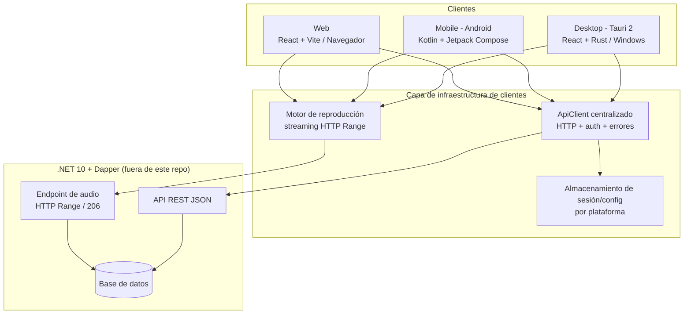

# Arquitectura global (Global Architecture)

Define la arquitectura común de los tres clientes: responsabilidades, comunicación con el backend, autenticación, configuración, errores, estado, infraestructura y seguridad.

## Diagrama general



## Responsabilidades de cada cliente

| Responsabilidad | Desktop | Mobile | Web |
|---|---|---|---|
| Render de UI | React (WebView2) | Jetpack Compose | React (navegador) |
| Lógica de producto | Frontend React + Rust nativo solo para capacidades del SO | ViewModels + repositorios | Frontend React |
| Reproducción de audio | Motor de reproducción abstraído en el cliente (ver [`audio-playback.md`](../apps/desktop/docs/audio-playback.md)) | `ExoPlayer` dentro de `MediaSessionService` (ver [`background-playback.md`](../apps/mobile/docs/background-playback.md)) | `HTMLAudioElement` u otro motor soportado por el navegador |
| Integración con el SO | System Tray, ventana, teclas multimedia (Windows) | MediaSession, notificación, permisos, ciclo de vida (Android) | APIs de navegador (Media Session API si se adopta) |
| Persistencia de sesión | Almacenamiento seguro por plataforma | DataStore + Keystore | Cookie httpOnly o almacenamiento según contrato |
| Acceso a datos | Exclusivamente vía `ApiClient` | Exclusivamente vía `ApiClient`/repositorios | Exclusivamente vía `ApiClient` |

## Comunicación con el backend

- **Toda** comunicación pasa por la capa de infraestructura definida en [api-integration.md](api-integration.md). Ningún componente llama a `fetch`/OkHttp/`invoke` directamente.
- **Prohibido** el acceso directo a las bases de datos desde cualquier cliente.
- Los contratos (endpoints, DTOs, códigos de error) se leen del repositorio del backend. **No se inventan** endpoints ni modelos; si se detecta una discrepancia entre la documentación y el backend, se registra en [`decisions/README.md`](decisions/README.md) y se notifica.
- El endpoint de audio se consume con soporte **HTTP Range** (solicitudes parciales `206`), sin descargar el archivo completo antes de reproducirlo.

```mermaid
sequenceDiagram
    participant UI as Componente UI
    participant SVC as Servicio/Repositorio
    participant API as ApiClient (infraestructura)
    participant BE as Backend .NET

    UI->>SVC: intención (ej. cargar álbum)
    SVC->>API: request tipado (endpoint + DTO + token)
    API->>BE: HTTP + Authorization + timeout
    BE-->>API: 200 JSON / 201 / 204 / error
    API-->>API: mapear error → ErrorType
    API-->>SVC: Result&lt;T, AppError&gt;
    SVC-->>UI: UiState actualizado (loading → ready/error)
    UI->>UI: render
```

## Gestión de autenticación

- El flujo exacto (login, refresh, logout) **se define según el contrato del backend** (ver [api-integration.md](api-integration.md#autenticación)).
- Patrón común: credenciales → token de acceso (y refresh si el backend lo define) → `Authorization: Bearer …` en cada request.
- Renovación: un solo mecanismo centralizado en el `ApiClient` (interceptor/interceptor equivalente). Los componentes **nunca** manejan tokens.
- Caducidad: ante `401`, el `ApiClient` intenta una única renovación en paralelo (single-flight); si falla, dispara `logout` global.
- Almacenamiento seguro por plataforma: ver [security.md](security.md#almacenamiento-seguro-de-tokens).

## Gestión de configuración

| Configuración | Dónde vive | Regla |
|---|---|---|
| URL base de la API | Variable de entorno por plataforma (`VITE_API_BASE_URL` en Vite; propiedad Gradle/`local.properties` en Android) | Nunca hardcodeada en componentes; nunca secretos en el repositorio |
| Tokens | Almacenamiento seguro por plataforma | Nunca en código fuente ni en logs |
| Preferencias de usuario (volumen, tema, repeat/shuffle) | Almacenamiento local por plataforma (localStorage/plugin-store/DataStore) | Solo preferencias; nunca datos de sesión en claro donde haya alternativa segura |
| Configuración de ventanas/permisos | `tauri.conf.json` + capabilities (Desktop), `AndroidManifest.xml` (Mobile) | Mínimo privilegio |

Los valores de configuración se leen **una sola vez** en la capa de infraestructura y se exponen como constantes tipadas al resto de la app.

## Manejo de errores

Estrategia unificada en [error-handling.md](error-handling.md). Reglas inamovibles:

1. Los errores se modelan como un tipo/enum propio de la app (`AppError` en TS, sealed class en Kotlin, `enum`/`thiserror` en Rust), **no** como strings sueltos ni excepciones crudas.
2. La infraestructura traduce errores técnicos (HTTP, red, decodificación) a ese tipo.
3. La UI traduce `AppError` a mensajes comprensibles. **Nunca** se muestran excepciones internas, rutas físicas, URLs completas ni información sensible.

## Gestión del estado

Cada plataforma modela el estado según sus estándares (Zustand/Context en React, `StateFlow` en Kotlin), pero respeta esta regla de propiedad:

| Estado | Dueño | réplicas |
|---|---|---|
| **Reproducción** (pista actual, posición, cola, volumen, shuffle/repeat) | Un único store/servicio de reproducción por plataforma | La UI solo **lee** ese estado; nunca lo duplica ni lo muta directamente |
| **Sesión/auth** | Store/servicio de sesión | El `ApiClient` lo consume; la UI solo ve `authenticated: boolean` |
| **Datos de servidor** (biblioteca, listas) | Repositorios → estado derivado en UI | Se revalidan al navegar; no se cachean en dos sitios |
| **Preferencias** | Almacenamiento de configuración | Se cargan al arranque |

En Mobile, el estado de reproducción es **propiedad de `MediaSessionService`**; la UI lo observa mediante `MediaController` (ver [`media-session.md`](../apps/mobile/docs/media-session.md)). En Desktop, es propiedad del store de reproducción que alimenta al motor (ver [`audio-playback.md`](../apps/desktop/docs/audio-playback.md)).

## Comunicación HTTP

Definida en [api-integration.md](api-integration.md): cliente centralizado, timeouts, cancelación, reintentos limitados, paginación y manejo de errores. Resumen:

- Un solo cliente por plataforma (mismo código base conceptual en las tres).
- Requests tipados (DTO de entrada/salida).
- Timeout por defecto para API: 10 s; streaming de audio: sin timeout (gestionado por el motor de reproducción).
- Cancelación activa (`AbortController` en TS, cancelación de corrutina en Kotlin).
- Reintentos: solo `GET`, solo errores transitorios, máximo 2, backoff exponencial.

## Consumo de archivos de audio

- Endpoint de audio existente + **HTTP Range** (`Range: bytes=…`), respuesta `206 Partial Content` con `Content-Range`.
- Reproducción **sin descargar el archivo completo**: el motor de reproducción y la pila de streaming del navegador/sistema piden solo los rangos necesarios (seek incluido).
- Calidad original: no se transcodifica en el cliente. Si un formato no es soportado por el dispositivo, se muestra un error claro y se evalúa una alternativa del backend (documentar la decisión; no inventar endpoints).
- Los clientes no conocen rutas físicas del servidor: usan el identificador de pista que el backend expone.

## Gestión de metadatos

- Los metadatos (título, artista, álbum, duración, portada) llegan del backend como DTOs y se modelan como entidades de dominio.
- Las portadas se cargan con caché nativa de cada plataforma (HTML `img`/`background-image` con caché del navegador; Coil en Android cuando se introduzca; caché de imágenes en Desktop según el motor elegido).
- **Los metadatos de la pista en reproducción alimentan también la UI del sistema** (notificación Android, y en Desktop la bandeja/SMTC cuando exista): se leen del mismo estado dueño, sin duplicar.
- Metadatos embebidos del archivo original (ID3, etc.) **no** se leen en el cliente: la fuente es el backend.

## Separación entre interfaz y lógica de negocio

- Los componentes renderizan estado y emiten intenciones; no deciden reglas.
- Las reglas de negocio (validación de cola, límites de listas, decisiones de reproducción) viven en módulos de dominio/servicios probables unitariamente.
- En Desktop, la distinción UI/Rust se documenta en [`apps/desktop/docs/architecture.md`](../apps/desktop/docs/architecture.md); en Mobile, la distinción Presentation/Domain/Data en [`apps/mobile/docs/architecture.md`](../apps/mobile/docs/architecture.md).

## Principios de seguridad

Resumen (detalle en [security.md](security.md)):

1. Sin secretos en el repositorio; configuración por variables de entorno/propiedades locales.
2. Comunicación exclusivamente HTTPS en producción.
3. Tokens almacenados de forma segura por plataforma; nunca en logs ni en URLs.
4. CSP habilitada en Desktop (hoy `null` es una deuda a corregir; ver [`apps/desktop/docs/architecture.md`](../apps/desktop/docs/architecture.md#deudas-detectadas-estado-actual)).
5. Mínimo privilegio: capabilities de Tauri y permisos Android solo los necesarios.
6. Validación de datos de entrada en cliente (UX) y de salida (defensa en profundidad); la autoridad real es el servidor.
7. Los mensajes de usuario no exponen internals, rutas físicas ni datos sensibles.

## Decisiones y deudas

Las decisiones arquitectónicas registradas y las deudas detectadas viven en [`decisions/README.md`](decisions/README.md). Actualizar ese documento ante cada decisión estructural.
